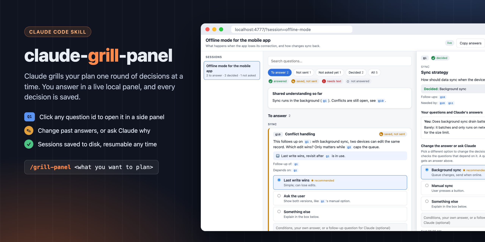

# claude-grill-panel



A Claude Code skill for stress-testing a plan. Claude "grills" you: it maps your plan as a tree of decisions,
asks the open ones round by round with a recommended answer for each, and keeps going until nothing is left
silently assumed. You answer in a **local HTML panel**, in chat, or both, and every session is saved to disk so
you can come back to it later.

The skill itself is called `grill-panel`, so you run it as `/grill-panel`.

## Features

- **Rounds, not a wall of questions.** Each round asks only the decisions whose prerequisites are already
  settled. Questions that depend on open answers wait for a later round, but you can see them coming.
- **Recommended answers.** Every question comes with Claude's recommendation, worded so "yes" accepts it.
- **Three ways to answer.** At the start of a session Claude asks which you want: **panel** (HTML), **chat**
  (text only, no server) or **both**. The choice is saved with the session.
- **Nothing gets lost.** The panel saves answers as you type, so a refresh is safe. If the server is down,
  answers wait in the browser and sync when it's back.
- **No copy-pasting.** **Send answers** in the panel wakes Claude up straight away (a small waiter process
  exits). **Copy answers** is there too, if you'd rather paste into chat.
- **Linked questions.** Question ids in any text ("follows up on Q1") are links. Click one to open that question
  in a side panel: read it in full, see what depends on it, change an answer you already gave, or ask Claude about
  it. Claude's replies are kept with the question.
- **Save now, send later.** Answers you save but haven't sent are listed under **Not sent**, and every question
  shows where it stands with an icon and a word (✓ answered, ✎ saved, not sent, ! needs text, ○ not answered),
  so nothing relies on colour alone.
- **Live updates.** When Claude adds a round, the open panel updates by itself.
- **Resumable sessions.** Several sessions per project, each stored in `docs/grill-panel/sessions/`. Pick any
  of them up days later.

## Requirements

- [Claude Code](https://claude.com/claude-code)
- Node.js 18 or newer. No npm packages: the server uses Node's built-in modules only.

## Install

Clone the repo straight into your Claude skills folder:

```bash
# macOS / Linux / Windows (Git Bash)
git clone https://github.com/Suleiman700/claude-grill-panel.git ~/.claude/skills/grill-panel
```

To update later:

```bash
git -C ~/.claude/skills/grill-panel pull
```

## Usage

In Claude Code, inside the project you're planning:

```
/grill-panel <what you want to plan>
```

For example: `/grill-panel adding offline mode to the mobile app`.

1. Claude asks how you want to answer (panel, chat or both).
2. In panel modes it starts the local server and gives you a link such as
   `http://localhost:4777/?session=2026-11-03-offline-mode`.
3. Answer the round: accept the recommendation, pick an option, or write your own answer. Then press
   **Send answers** (or reply in chat).
4. Claude records the decisions, works out the next round, and repeats.
5. When every branch is settled, Claude posts a final summary and asks you to confirm it. It won't act on the
   plan before you do.

To continue an earlier session, run `/grill-panel` on the same topic. Claude finds the open session and picks up
where you left off.

## Where sessions are stored

In the project you're working in:

```
docs/grill-panel/sessions/
  <id>.json           written by Claude: questions, options, recommendations, decisions, summary
  <id>.answers.json   written by the panel's server: what you picked or typed
```

Session ids are a date plus a short slug, e.g. `2026-11-03-offline-mode`. The full format is in
[`reference/schema.md`](reference/schema.md). Commit the folder if you want the decisions kept with the
project, or add it to `.gitignore` if you don't.

## Running the server by hand

Claude starts the server for you. To open the panel without Claude, e.g. to look over old sessions:

```bash
node ~/.claude/skills/grill-panel/server/server.mjs --dir <project>/docs/grill-panel [--port 4777]
```

Then open `http://localhost:4777/`. If the port is taken it tries the next ones, and if a server is already
running for the same folder it reuses it. The first line of output shows the URL.

## Files

| Path | What |
|---|---|
| `SKILL.md` | The skill: how Claude runs the interview and keeps the session files. |
| `reference/schema.md` | The session and answers file format. |
| `server/server.mjs` | Local server (127.0.0.1 only): serves the panel, lists sessions, saves answers, pushes live updates. |
| `server/wait.mjs` | Exits when you send answers for a session; Claude runs it in the background. |
| `panel/` | The panel (plain HTML, CSS, JS; no build step). |

## Security

- The server listens on 127.0.0.1 only, so it isn't reachable from other machines.
- Session and question ids are checked against a strict pattern, so requests can't reach files outside the data
  folder.
- The server only ever writes `<id>.answers.json`. Request bodies are capped at 1 MB.
- The panel escapes all session text before showing it.
